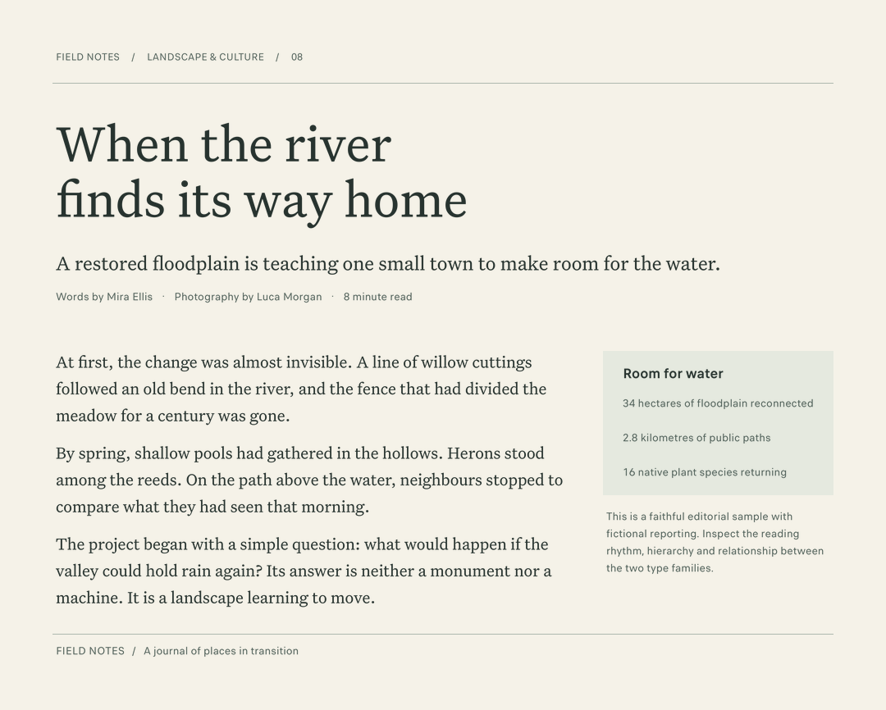
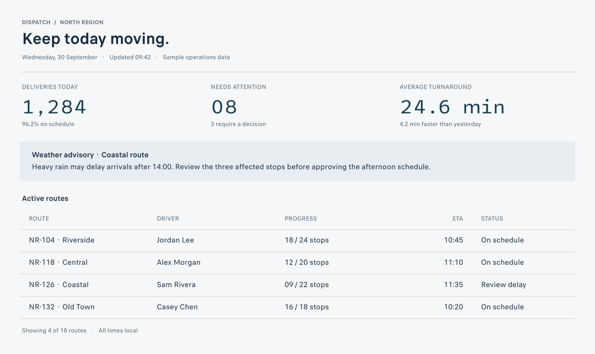

# Type Evidence — Find the type. See the evidence.

Discover open and commercial fonts, compare them using your real text, and hand an AI agent the exact files and styles to implement. Type Evidence combines a **browser font explorer**, an **offline family directory**, **reproducible open-font packs**, and a **local typography toolkit with CLI and MCP interfaces**.

[Explore fonts](https://gavinjudd.github.io/type-evidence/) · [Get started](docs/getting-started.md) · [Agent / MCP setup](docs/agents.md) · [Font packs](docs/collection-v3.md) · [Directory provenance](docs/font-directory.md)

## A useful starting point

Browse the directory before installing anything. Search by family, foundry or category, filter open and commercial options, try your text, and save a shortlist with a portable brief. Open-font browser previews load only when requested. Commercial entries link to their official providers; purchased files can be brought into the local toolkit.

Directory listings, browser previews and exact local faces are different kinds of evidence. The explorer makes those states visible. A family name or provider preview is not a verified local font file.

## From discovery to real typography

| Start with | What you can do |
| --- | --- |
| A project direction | Search the bundled open/commercial directory offline, filter by category, provider, variable status and tags |
| An open-font shortlist | Inspect download sizes, fetch a small task-specific pack or named families, resume verified downloads |
| Purchased or existing fonts | Register their local directory, preserve provenance, and index exact faces without copying or installing them |
| Real project copy | Check glyph coverage and required styles, compare candidates at actual sizes, compose roles together |
| An AI agent | Use the same bounded discovery, inspection and rendering operations through JSON CLI or local stdio MCP |

The local renderer uses verified bytes through HarfBuzz and FreeType, refuses missing glyphs instead of substituting a fallback, and writes PNG evidence plus implementation recipes. Optional FontCLIP retrieval adds rendered-letterform similarity. Scores and metadata inform a choice; the final design decision still needs judgment.

## Get started

Python 3.10+ and Git are required. Install from source; no package-registry publication is assumed:

```sh
git clone https://github.com/gavinjudd/type-evidence.git
cd type-evidence
python3 -m venv .venv
.venv/bin/python -m pip install -e .
source .venv/bin/activate
type-evidence doctor
```

On Windows, create the environment with `py -3 -m venv .venv` and run `.\.venv\Scripts\python.exe -m pip install -e .`; use `.\.venv\Scripts\type-evidence.exe` for subsequent commands. [Full platform instructions](docs/getting-started.md).

### Discover immediately

```sh
type-evidence directory --query 'serif' --limit 6
type-evidence directory --license-kind commercial --limit 6
type-evidence directory --stats
type-evidence packs
```

No local catalog, font download or model is required for directory search. Results retain their source URLs and dated provenance. Directory IDs describe families; exact local face IDs come from indexing.

### Get real open fonts

```sh
type-evidence fetch --pack starter --plan
type-evidence fetch --pack starter
type-evidence index
type-evidence search --role ui --text 'Review 24 requests' --weight 400 --upright --visual off --limit 6
```

Use repeated `--pack` flags to combine packs or `--family 'Inter'` to select one family. The download plan shows source bytes before acquisition. [Available packs and source pins](docs/collection-v3.md).

### Bring purchased fonts

```sh
type-evidence import-local /absolute/path/to/fonts --id my-fonts --index
```

Local files stay in place. Registration preserves existing sources and refuses conflicting IDs. Font availability does not establish usage rights; [font licensing remains separate](docs/licensing.md).

### Compare and apply

Copy exact IDs from local search results, then replace these placeholders:

```sh
type-evidence family EXACT_ID
type-evidence compare BASELINE_ID CANDIDATE_ID --text 'Review 24 requests' --sizes 15 24 48 --out library/comparison
type-evidence compose --spec project-composition.json --out library/composition
type-evidence resolve EXACT_ID
```

Start a composition from [examples](examples/) and replace its role IDs with fonts in your catalog. Render roles together, inspect the result, and revise. Recipes record exact assets, axes, features and line heights; stage authorized assets and verify the target browser before shipping.

Put `--catalog /absolute/path/catalog.sqlite` **before** each subcommand when using a custom catalog. Successful CLI output is JSON.

## See typography in context

These are actual harness outputs using exact local faces, with fictional sample content. They illustrate different applications, not automatic design recommendations or a grant to redistribute the pictured fonts.

| Reading and editorial | Interfaces and data | Expressive display |
| --- | --- | --- |
| [](evidence/v0.2/composition-examples/editorial/manifest.json) | [](evidence/v0.2/composition-examples/interface/manifest.json) | [](evidence/v0.2/composition-examples/poster/manifest.json) |

Each image links to its exact-face manifest. [Composition specs](examples/) and the [recorded browser checks](evidence/v0.2/composition-browser/README.md) show how previews become implementation recipes.

## Connect an agent

Read [AGENTS.md](AGENTS.md) for the bounded discover → acquire → inspect → compose → apply loop. [MCP setup](docs/agents.md#local-setup-and-mcp) uses a local stdio process and works before a local catalog exists. `font_directory` and `font_packs` help the agent get started; exact font operations become available after indexing.

Optional visual discovery requires `.[visual]`, an explicit approximately 653 MB pinned checkpoint download, and a local rendered-font index. Search never downloads weights. [Setup, script coverage and storage](docs/getting-started.md#add-optional-visual-discovery).

## Scope and verification

The new [directory snapshot](docs/font-directory.md) and [open-font packs](docs/collection-v3.md) report their own counts and provenance. Listings, downloadable families, font files and indexed faces are counted separately. The older mixed collection remains available through an unfiltered `fetch`; allow roughly 6 GB for those source collections. Its historical catalog recorded **27,520 faces and 8,041 distinct family names**. [Legacy collection scope](docs/collection-v2.md).

The [v0.3 verification report](evidence/v0.3/README.md) records tests, acquired/indexed font counts, browser checks and remaining limits for this overhaul. Historical visual coverage and evaluations remain in the [v0.2 evidence](evidence/v0.2/README.md). The three-case v0.2 held-out study did not improve final compositions over basic access to the same fonts; broader coverage and passing tests do not demonstrate better taste.

## Contribute

See [CONTRIBUTING.md](CONTRIBUTING.md) for synthetic-font development and extension points. Useful contributions include source metadata corrections, additional official catalogs, acquisition improvements, retrieval failures and actual design evaluations. Report reproducible issues with the [issue forms](https://github.com/gavinjudd/type-evidence/issues/new/choose).

## License

The harness code and documentation are [MIT licensed](LICENSE). Fonts, model weights and other third-party assets retain their own terms. No font binaries or model weights are included in this repository. Read the [licensing and attribution guide](docs/licensing.md) before distributing assets.
