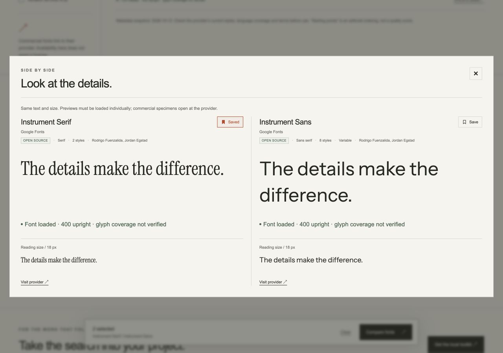

# Type Evidence v0.3 overhaul verification

Checked October 12, 2026 (America/New_York). Upstream retrieval timestamps use UTC. This is implementation and validation evidence; it does not claim a measured improvement in aesthetic decisions or a production deployment.

## What changed

- An offline directory of **2,167 family listings**: **1,950 Google Fonts** and **217 commercial listings** from seven official foundry catalogs. Search, details, facets and pagination work before a local catalog exists. [Provenance and limits](../../docs/font-directory.md).
- Reproducible acquisition for **1,940 currently listed open families**, plus a separate selection including 81 historical/experimental families. Nine packs, exact family selection, download plans, verified resume and retained license sidecars. [Pins and pack sizes](../../docs/collection-v3.md).
- A browser explorer with explicit Google previews, commercial provider links, metadata filters, accent-insensitive search, saved shortlists, Markdown export and comparison. Directory listings and browser previews remain distinct from hash-verified local faces.
- Direct local-font registration, atomic source-config updates, preservation of existing sources when adding packs, bounded acquisition output and scoped next-command guidance.
- CLI/MCP directory parity and an MCP server that can initialize before a local catalog exists and sees newly indexed families on the next request. Existing exact-face discovery, composition and rendering continue to use the same underlying operations.

## Real acquisition and indexing

| Check | Result | Evidence |
| --- | --- | --- |
| Starter pack, public CLI path | 20 families, 43 faces, 29 variable faces, zero indexing issues | [Index receipt](starter-index.json) |
| `discovery-300` + `global` | 349 families, 849 faces, 260 variable faces, zero indexing issues | [Index receipt](expanded-index.json) |
| Larger acquisition | 1,863 files including fonts, licenses and metadata; 446,782,963 bytes verified against pinned Git blobs | [Acquisition guide](../../docs/collection-v3.md#recorded-acquisition-check) |
| Repeat acquisition with networking disabled | Existing source bytes and SHA-256 receipts reverified successfully | Recorded by acquisition agent; no new network bytes |
| Existing macOS font directory import | 780 usable faces across 373 family names; 1 oversized asset and 4 parse/render failures reported | [Index receipt](system-index.json) |
| Combined local catalog, original sources retained | 29,091 faces / 8,668 family names; 1,571 added exact faces; zero baseline faces removed | [Combined receipt](combined-index.json) |
| Exact local specimens | Inter, Instrument Sans, Source Serif 4 and Fraunces at weight 400, sizes 16/32/48 | [Render receipt](starter-render-summary.json) · [Image](starter-comparison.png) |
| Local proprietary-font workflow | Imported Helvetica Neue; exact-byte rendering succeeded without fallback | [Render receipt](system-render-summary.json) |

The 849-face open-source sample has 833 embedded open-license signals and 16 unknown embedded-rights records; included upstream license files remain separate evidence. The system-font import likewise preserves unknown or restricted notices. These checks do not grant redistribution or embedding rights. No font binaries are committed.

## Browser checks

Verified on the local candidate in the Codex browser: open/commercial and foundry filters; Inter and Instrument family search; explicit Google font loads; serif/sans comparison; commercial provider-only specimens; saving and reopening a shortlist; actual exported brief contents; and a 390px mobile viewport with no horizontal overflow. Preview labels explicitly state that glyph coverage is not verified. The exact local rendering workflow performs its own no-fallback checks.

[Mobile screenshot](explorer-mobile.jpg). Browser previews depend on Google availability and may change independently of the pinned local packs. Shortlists stay in browser storage; export is the portable handoff.

## Automated checks and packaging

The final local test counts and artifact hashes are recorded in [verification.json](verification.json). Python tests use generated synthetic fonts, packaged metadata and mocked acquisition endpoints. JavaScript tests cover filtering, search ranking, accent handling, preview URL restrictions, face selection, saved-state recovery, export and parity between the packaged and website directories.

The v0.3 wheel was built and installed outside the repository. Offline directory discovery returned all 2,167 listings, and a named Inter download plan worked without a repository-local source lock. The bundled directory and pack manifests are package data. The source review archive is independently checked for CRC, manifest hashes, safe paths, font-file magic and known secret signatures.

## Limits

- Only the recorded packs were downloaded and indexed in this run. The whole 1,940-family pack was planned from pinned files, not fully executed.
- The optional FontCLIP model and visual indexes were not rebuilt for every newly acquired face. Existing held-out findings remain unchanged; no new quality advantage is claimed.
- Commercial listings are acquisition leads. Most providers do not publish structured categories or complete style metadata; those fields remain unknown rather than inferred.
- Local source registration preserves sequential updates. Concurrent independent processes writing the same source configuration are not serialized.
- Local browser checks do not establish every browser, OS, script, glyph or production-engine behavior. The separate native CI checks validate the synthetic core and JavaScript suite.
